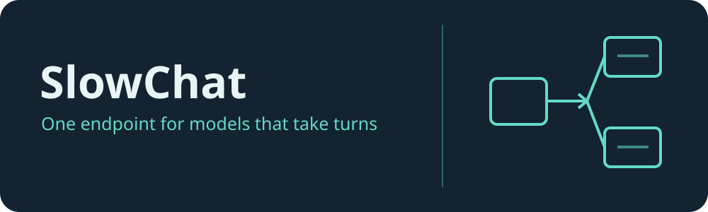

# SlowChat

Route local model requests through one HTTP API when your machine can't keep every model in GPU memory at once.

## Table of Contents

- [Overview](#overview)
- [Technologies](#technologies)
- [Configuration](#configuration)
- [Interface](#interface)

## Overview

SlowChat was written for small hosts that need to load and stop model processes as requests arrive. It is a router, not a model server. Configure a separate backend for each model, and use only trusted operator-authored startup commands.

## Technologies

- [Flask](https://flask.palletsprojects.com/)
- [Waitress](https://docs.pylonsproject.org/projects/waitress/en/stable/)
- [aiohttp](https://docs.aiohttp.org/)
- [OR-Tools](https://developers.google.com/optimization/)
- [vLLM](https://docs.vllm.ai/)

## Configuration

Review [`config.json`](config.json) and [`slowchat.py`](slowchat.py). Match each configured name to the name exposed by its backend. This is local infrastructure; the launcher listens on all interfaces, so keep it isolated and do not expose it publicly. Runtime compatibility wasn't verified.

## Interface

SlowChat lists configured models at `GET /v1/models` and forwards completion, chat completion, embedding and moderation requests to the selected backend. The backend decides which operations it supports. The interface is OpenAI-style; full compatibility is not promised.
